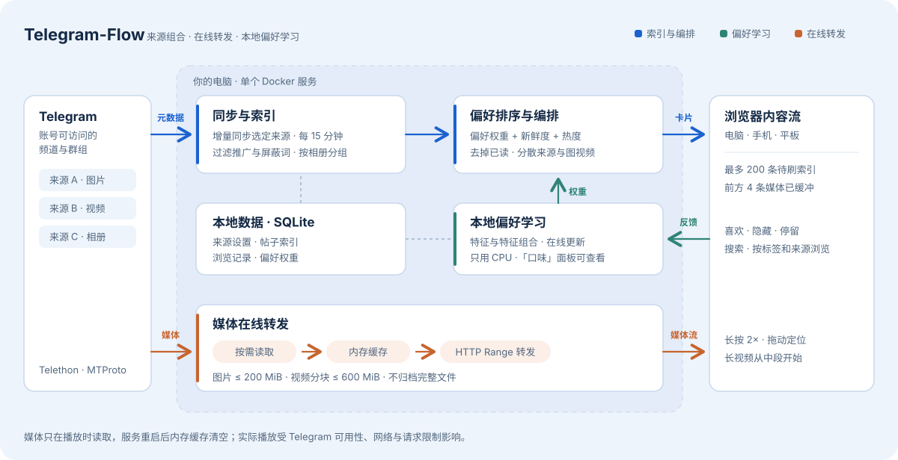

<div align="center">


# Telegram-Flow

把你在 Telegram 关注的频道和群组，合成一条可以连续浏览、会学习你偏好的内容流。


[快速开始](#快速开始) · [使用前须知](#使用前须知) · [工作原理](#工作原理) · [Agent 部署指南](AGENTREADME.md) · [架构说明](docs/ARCHITECTURE.md)

</div>

Telegram-Flow 是一个自托管的 Web 应用。它在你自己的电脑上用 Docker 运行，通过你的 Telegram 账号读取你选中的来源，把其中的图片、视频和相册排成一条信息流。电脑、手机和平板都用浏览器打开同一个服务。

## 功能

- **多来源合流**：从你的账号已加入的频道和群组里勾选来源，把其中带图片或视频的帖子排进同一条流。排序综合你的偏好、发布时间和热度（帖子在 Telegram 上的回应数与评论数），并让不同来源、图片与视频交错出现。
- **在线转发**：这里的“转发”指 Telegram → 你的电脑 → 浏览器的传输，不会在 Telegram 里把消息转发给任何人。媒体在播放时才读取，只在内存里短暂缓存，不在硬盘上保存完整文件。
- **流畅浏览**：提前准备好接下来几条内容，视频支持拖动进度、长按倍速，长视频从中段开始。
- **关键词偏好学习**：根据你的喜欢、隐藏和停留时间，在本机给帖子的文字特征打分，例如来源频道、话题标签、正文关键词、@提及、图片或视频、视频时长，以及它们的两两组合。「口味」面板能看到学到的关键词。
- **多设备**：同一 Wi-Fi（或同一 Tailscale 网络）里的手机和平板扫码即可访问，可以添加到主屏幕，与电脑共用一份浏览记录和偏好。

## 使用前须知

- **它不是云服务**。所有设备都连到你自己电脑上的服务，电脑需要开机、联网，并且 Docker 在运行。手机必须和电脑在同一个局域网（或同一个 Tailscale 网络），离开家里的 Wi-Fi 就打不开。
- **偏好学习只看文字和来源，不看画面**。系统不识别图片和视频里的内容，只学习帖子附带的文字、标签和来源。没有文字说明的帖子，主要靠来源和媒体类型来判断。
- **停留时间也算信号**。停在一条内容上不动会被当成“感兴趣”，快速划走会被当成“不感兴趣”，开着页面去做别的事会让结果偏差。明确点「喜欢」或「没兴趣」最准。
- **所有设备算同一个人**。手机、平板和电脑共用一份记录，谁刷都会影响同一份偏好；在一台设备上看过的，在其他设备上也不会再推。
- **只显示图片和视频**。纯文字消息不会同步进来。原消息被删除后，对应的媒体也就读不到了。
- **「加入」会改动你的 Telegram 账号**。在「频道」面板里粘贴链接后点「加入」或「全部加入」，你的账号会真的加入这些频道或群组。只勾选已加入的来源不会改动账号。
- **新关注的频道会自动加入**。你在 Telegram 里新加入的频道，会在下一轮同步（约 15 分钟内）或打开「频道」面板时自动勾选并开始同步；新加入的群组，以及标题命中过滤词表（`data/blocklist.txt`）的频道，只出现在列表里，不会自动勾选。不想看的在面板里取消勾选即可，之后不会被重新勾上。
- **新内容不是实时的**。服务大约每 15 分钟同步一次选中的来源。第一次同步、或 Telegram 限制请求频率时会更慢，页面会显示倒计时。

## 快速开始

你需要：

- [Docker Desktop](https://www.docker.com/products/docker-desktop/)（macOS、Windows）或 Docker Engine + Compose 插件（Linux）
- 一个 Telegram 账号，以及在 [my.telegram.org](https://my.telegram.org) 的「API development tools」里创建的 `api_id` 和 `api_hash`

**1. 获取代码并构建镜像**

```sh
git clone https://github.com/YangNuoCheng/Telegram-Flow.git
cd Telegram-Flow
docker compose build
```

**2. 登录 Telegram（只需一次）**

```sh
docker compose run --rm --no-deps tg-feed python login.py
```

按提示依次输入 `api_id`、`api_hash`、手机号、Telegram 发来的验证码，以及两步验证密码（如果开启了）。登录状态保存在项目里的 `data/` 目录。

**3. 启动服务**

macOS / Linux：

```sh
./start.sh
```

Windows（PowerShell）：

```powershell
powershell -ExecutionPolicy Bypass -File .\start.ps1
```

脚本会打印两个链接：一个给本机浏览器，一个给同一 Wi-Fi 下的手机和平板。打开本机链接，点「频道」勾选来源，等第一次同步完成后就能开始浏览。

> [!IMPORTANT]
> 访问链接里带有设备口令，相当于这台服务的钥匙，只在自己的设备上使用，不要转发。

**手机和平板**：连上和电脑相同的 Wi-Fi，在电脑页面点「手机」扫二维码，之后可以在手机浏览器里「添加到主屏幕」。电脑需要保持开机。

### 常用命令

| 操作 | macOS / Linux | Windows |
| --- | --- | --- |
| 启动，或代码更新后重建 | `./start.sh` | `.\start.ps1` |
| 停止（保留数据） | `./stop.sh` | `.\stop.ps1` |
| 查看状态和日志 | `docker compose ps`、`docker compose logs --tail 80 tg-feed` | 同左 |
| 重新登录 | 先停止，再运行第 2 步 | 同左 |

Windows 默认不允许直接运行脚本。如果 `.\start.ps1` 报“禁止运行脚本”，就用上面那条带 `-ExecutionPolicy Bypass` 的完整命令。

## 使用

- **切换内容**：上下滑动、滚动鼠标滚轮或按方向键。
- **相册翻页**：左右滑动或点两侧按钮；多图帖会自动翻页。
- **喜欢**：双击画面或点「喜欢」，内容会进入「喜欢过」，同时作为正向反馈。
- **没兴趣**：点「没兴趣」隐藏这条，同时作为负向反馈。
- **视频**：拖动底部进度条定位，按住画面临时 2 倍速。
- **搜索和筛选**：用顶部搜索栏，或点标签、频道名只看相关内容。
- **查看偏好**：点「口味」，查看学到的关键词、组合和不感兴趣的特征。

看过的内容不会在「为你推荐」和「最新」里重复出现。遇到 Telegram 的请求频率限制时，页面会显示倒计时并自动继续。

## 配置

| 项目 | 说明 |
| --- | --- |
| `TG_FEED_LAN_IP` | 手机访问用的局域网 IP。启动脚本会自动检测；检测不准时手动指定，例如 `TG_FEED_LAN_IP=192.168.1.18 ./start.sh`，Windows 上先运行 `$env:TG_FEED_LAN_IP="192.168.1.18"` |
| `data/blocklist.txt` | 过滤词，一行一个，含有这些词的帖子不会出现 |
| `data/read_domains.txt` | 额外的全文阅读站点，一行一个不带后缀的站点名（如 `example`）。帖子或评论里出现这些站点的链接时，多图帖可以在应用里打开全文 |
| 端口 | 默认 `8978`。要换端口，改 [compose.yaml](compose.yaml) 里 `ports` 冒号左边的数字；启动脚本打印的链接仍写 8978，需要手动换成新端口 |

## 工作原理



服务内部有三条互相独立的路径。**索引与编排**定时同步选中来源的帖子信息，排好序后以卡片形式发给浏览器。**偏好学习**根据你的浏览反馈更新本机上的权重，影响下一次排序。**媒体在线转发**在播放时才去 Telegram 读取图片和视频，经内存缓存转给浏览器。模块划分、接口和数据流见 [架构说明](docs/ARCHITECTURE.md)。

## 数据与隐私

所有数据都在项目的 `data/` 目录里：Telegram 登录会话、API 配置、来源设置、帖子索引、浏览记录、偏好权重和访问口令。媒体只放在服务进程的内存缓存里，重启后清空。偏好模型在本机用 CPU 计算，不调用任何外部 AI 服务。

> [!WARNING]
> `data/telegram.session` 等同于你的 Telegram 登录状态，拿到它的人可以用你的账号读写消息。不要上传、分享或提交到 Git。不再使用时，可以在 Telegram 的「设置 → 设备」里结束这个会话。

`data/` 已被 Git 和 Docker 构建排除。迁移到另一台电脑时，先停止服务，再连同 `data/` 一起复制整个项目目录。同一份 `data/` 同一时间只给一个服务实例使用。

> [!NOTE]
> 服务面向个人电脑和家庭局域网，没有为公网部署做额外加固。

## 开发

代码结构和约定见 [AGENTS.md](AGENTS.md) 和 [架构说明](docs/ARCHITECTURE.md)。测试使用模拟数据，不需要登录 Telegram：

```sh
uv sync --locked
.venv/bin/python -m unittest discover -s tests -v
node tests/test_queue.cjs
node tests/test_hold.cjs
docker compose config --quiet
```

改完代码后运行启动脚本重建容器，再访问 `/api/status`，确认 `ready` 为 `true`。

## 许可证

[MIT](LICENSE)

---

Telegram-Flow 是独立项目，通过 Telegram API 工作，与 Telegram 官方没有隶属关系。
