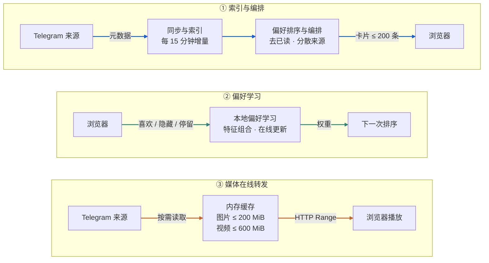
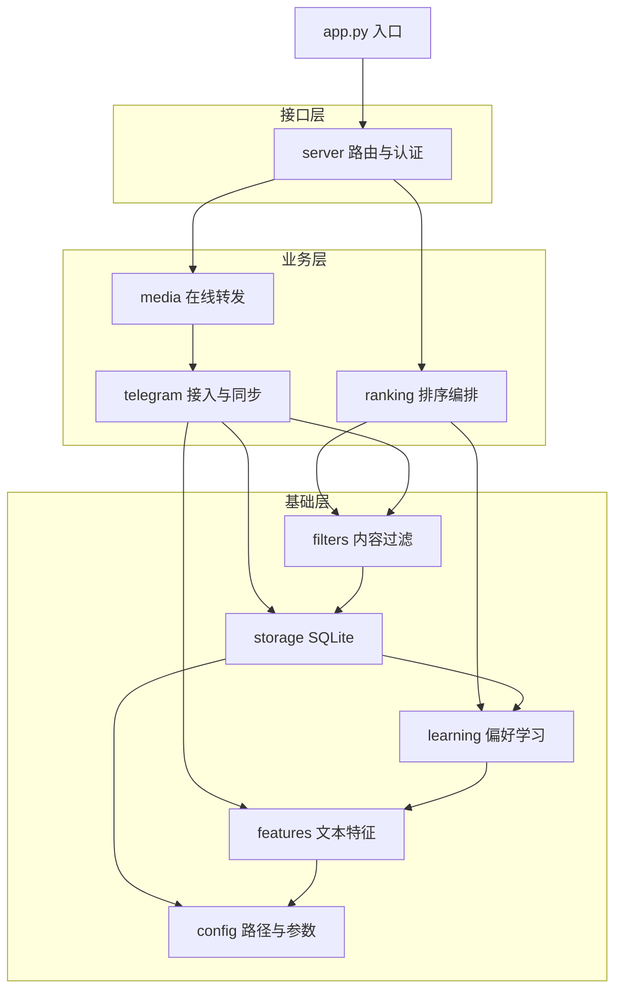

# Telegram-Flow 架构

Telegram-Flow 是单用户、单服务的 Telegram 内容聚合与在线媒体转发应用。前端为原生 HTML/CSS/JavaScript，后端为 Python aiohttp，Telethon 负责 MTProto 访问，SQLite 保存索引与学习状态。默认模型只需要 CPU。[后端包](../telegram_flow/)、[阅读器](../web/index.html)、[依赖](../pyproject.toml)。

## 数据流

蓝线是索引与编排，绿线是偏好学习，橙线是媒体在线转发。卡片和媒体分开传输；浏览反馈只改变下一次排序。来源设置、帖子索引、浏览记录和偏好权重都存在本机 SQLite。

“转发”是 Telegram → 本机服务 → Web 浏览器的媒体传输路径。当前主流程在浏览器消费内容。Telegram 的账号权限、源消息状态、网络和请求限制共同决定实际可用内容；索引存在不保证媒体永远可读。

## 三条流水线

### 索引与编排

`Telegram.start()` 复用本机会话；`Telegram.loop()` 周期同步选定来源，默认每 15 分钟一轮。`sync_channel()` 每来源每轮最多取 200 条消息，元数据写入 `item`，来源设置写入 `channel`。同组媒体按 `gkey` 合并。[telegram.py](../telegram_flow/telegram.py)：`sync_all()`、`sync_channel()`；[config.py](../telegram_flow/config.py)：`SYNC_BATCH`、`SYNC_EVERY`。

[ranking.py](../telegram_flow/ranking.py) 的 `feed()` 读取本地索引与权重，组合个人偏好、新鲜度、来源内相对热度及少量探索。推荐和最新流过滤已读与隐藏项；`spread_pick()` 在候选允许时保持同来源至少间隔 2 条，最近 20 条内单来源最多 25%，并尽量交错图片和视频。来源或类型不足时会放宽约束；收藏流按收藏时间排序。

### 在线媒体转发与预载

页面启动后 `load()` 从 `/api/feed` 请求最多 200 条卡片元数据，队列不足 100 条时补充。`fill()` 最多并行准备 3 条，维持前方 4 条就绪媒体；媒体完成顺序不会改变插入顺序。[web/index.html](../web/index.html)：`BUFFER`、`AHEAD`、`PREP`、`prepare()`、`mediaReady()`。

图片通过 `/media/image/{chat}/{msg}` 读取。视频通过 `/media/video/{chat}/{msg}` 支持 HTTP Range 与分块读取；`warm_video()` 提前拉取文件头、MP4 元数据及目标播放位置附近分块。缓存只在服务进程内存中，图片和视频分块分别有约 200 MiB、600 MiB 上限。[media.py](../telegram_flow/media.py)：`image()`、`video()`、`get_chunk()`、`warm_video()`。

Telegram 消息查询按相同消息合并，并串行控制元数据查找。遇到 FloodWait 后记录冷却截止时间，通过 HTTP 429 / `Retry-After` 与状态接口传达；前端保留待播队列并显示倒计时。已缓存媒体仍可读取。实际连续播放受带宽和缓存覆盖影响。[回归检查](../tests/test_requests.py)、[队列检查](../tests/test_queue.cjs)。

### 本地偏好学习

特征包括频道、标签、正文词、提及、媒体类型、时长档，以及部分两两组合。预测使用加权特征和；每次反馈按预测误差更新权重，并加入衰减。[features.py](../telegram_flow/features.py)：`tokens()`、`card_features()`；[learning.py](../telegram_flow/learning.py)：`model_vec()`、`engagement()`、`update()`。

喜欢和隐藏提供明确正负信号；停留时长与个人近期中位停留比较，图片和视频分别计算基线。已展示事件用于去重，不直接训练偏好。模型权重和历史事件保存在 SQLite；「口味」读取 `/api/taste` 展示已有证据的特征。[learning.py](../telegram_flow/learning.py)：`ACTION_Y`；[server.py](../telegram_flow/server.py)：`event()`、`taste()`。

该模型解释的是行为与文本特征的关联。当前没有经过离线评测证明的推荐提升指标，没有部署外部大模型、向量数据库或视觉理解服务。停留也可能来自分心，应结合明确反馈理解。

## 代码组织

后端是 `telegram_flow` 包，每个模块负责一件事，依赖只从上层指向下层，没有循环引用。`app.py` 和 `login.py` 是两个很薄的入口。图中箭头表示“依赖”，只画主要依赖；`server` 和 `ranking` 还会直接引用 `storage`、`features` 等底层模块。

| 位置 | 负责什么 | 主要符号 |
| --- | --- | --- |
| `telegram_flow/config.py` | 数据目录、端口、同步批量与间隔、默认过滤词 | `DATA`、`WEB`、`PORT`、`SYNC_BATCH` |
| `telegram_flow/storage.py` | 建表与迁移、过滤词表 | `db()`、`init_storage()`、`blocklist()` |
| `telegram_flow/features.py` | 话题、提及、关键词提取；频道模板词识别 | `tokens()`、`card_features()`、`flabel()` |
| `telegram_flow/learning.py` | 特征组合、反馈信号、在线更新、全量重训练 | `model_vec()`、`engagement()`、`update()`、`retrain()` |
| `telegram_flow/filters.py` | 屏蔽词、推广段落识别、频道固定尾巴 | `refresh_filters()`、`strip_ads()` |
| `telegram_flow/telegram.py` | 会话、来源列表、增量与历史同步、消息缓存、限流 | `Telegram`、`TG`、`describe()` |
| `telegram_flow/ranking.py` | 候选读取、打分、来源与媒体类型分散、卡片组装 | `feed()`、`spread_pick()`、`card()` |
| `telegram_flow/media.py` | 图片与视频分块转发、内存缓存、预载、阅读页 | `image()`、`video()`、`warm_video()`、`pages()` |
| `telegram_flow/server.py` | HTTP 路由、来源管理、反馈接口、设备认证、启动 | `main()`、`same_origin()`、`get_feed()`、`event()` |
| `telegram_flow/admin.py` | 部署用命令行：在容器内经回环地址查看状态、列出与选择来源、等待同步；不引用其他模块 | `status`、`channels`、`select`、`wait` |
| `web/index.html` | 阅读器：手势、队列、预载、搜索、来源选择、偏好面板 | `fill()`、`prepare()`、`load()` |
| `web/about.html`、`web/architecture.svg` | 项目介绍页与架构图 | — |
| `login.py` | 交互式首次登录 | — |
| `Dockerfile`、`compose.yaml`、`start.sh` / `stop.sh`（macOS、Linux）、`start.ps1` / `stop.ps1`（Windows） | 构建、健康检查、端口、数据挂载、启停 | — |
| `tests/` | 模拟 Telegram 的请求合并、限流、队列顺序、长按恢复 | — |

## 主要接口

以下是开发索引，参数与返回以 `telegram_flow/server.py` 为准；带写入行为的接口会改变个人状态。

| 方法 / 路径 | 用途 / 主要参数 |
| --- | --- |
| `GET /about` | 项目介绍页；沿用设备访问认证 |
| `GET /architecture.svg` | 架构图；沿用设备访问认证 |
| `GET /api/status` | `configured`、`ready`、`syncing`、`cards`、`channels`、`signals`、`retry_after` |
| `POST /api/feed` | `mode`、`feature`、`exclude`、`recent`、`recentMedia`、`size`（1–200）；只读取本地索引 |
| `GET /api/channels` | 读取 Telegram 对话并返回来源设置，会请求 Telegram |
| `POST /api/channels` | `ids` 覆盖当前选择，并启动同步 |
| `POST /api/more` | 请求向更早历史补充索引 |
| `POST /api/event` | `key`、`kind`、可选 `ms`，记录反馈并按事件类型更新权重 |
| `GET /api/taste` | 正向、负向与组合偏好 |
| `GET /api/lan` | 当前局域网入口及二维码，响应包含设备口令 |
| `POST /api/prefetch/{chat}/{msg}?at=…` | 目标视频位置预载 |
| `GET /media/image/{chat}/{msg}` | 图片按需读取 |
| `GET /media/video/{chat}/{msg}` | 视频 Range 读取 |

## 部署与状态

一个 Compose 服务 `tg-feed`，一个 Python 进程；SQLite 和会话仅由这一实例使用。主机 `./data` 挂载到 `/app/data`。数据库采用 DELETE journal 模式，维护时不要在宿主机并发写入挂载中的数据库。容器健康只证明 HTTP 服务可响应，是否完成 Telegram 登录应额外检查 `ready`。

默认绑定 `0.0.0.0:8978`。回环访问直接放行；其他设备需要访问口令与 Cookie，写请求还检查 Origin。Docker Desktop 转发地址有特殊兼容处理；当前认证不能替代公网部署所需的完整访问控制。局域网 IP 通过 `TG_FEED_LAN_IP` 传入。私有数据见 [README](../README.md#数据与隐私)。
